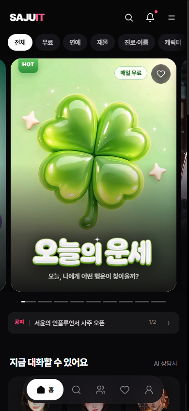
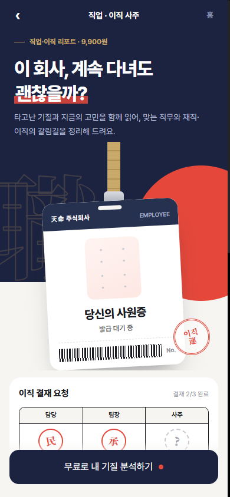
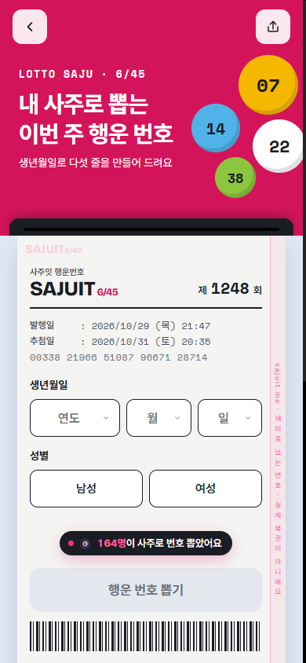

# 사주잇 (Sajuit)

> 4명이 함께 만든 **사이드 프로젝트**. 생년월일시만 넣으면 AI가 사주를 풀어 주는 운세 서비스로, 실제 결제와 사용자가 있는 운영 서비스입니다.

  

| 구분 | 기간 | 팀 | 내 역할 |
|---|---|---|---|
| 사이드 프로젝트 | 2026.06 – 진행 중 | 4명 | 프론트엔드, 결제, 인증, 운영 기능 개발 (팀 커밋 중 약 250건) · 광고 영상과 마케팅 대부분 담당 |

 

<table>
  <tr>
    <td align="center"></td>
    <td align="center"></td>
    <td align="center"></td>
    <td align="center"></td>
  </tr>
  <tr>
    <td align="center">메인</td>
    <td align="center">연애 리포트 「연설아」</td>
    <td align="center">직업·이직 사주</td>
    <td align="center">로또 사주</td>
  </tr>
</table>

 

## 어떤 서비스인가

- 오늘의 운세, 연애 궁합, 금전운, 직업·이직 사주, 작명, 로또 번호 등 사주 콘텐츠를 한곳에서 제공
- 생년월일시로 명식을 계산하고, AI가 그 결과를 읽기 쉬운 리포트로 풀어 줌
- 무료 미리보기 → 결제 → 전체 리포트 열람 구조. 쿠폰, 찜, 후기, 공유 기능 포함

 

## 내가 한 일

**결제**
- 토스페이먼츠 연동과 PG 심사 대응. 웹훅으로 결제 누락을 막고, 결제 실패 시 결과 화면으로 돌아오도록 흐름 정리
- API를 직접 호출해 유료 결과를 가져가던 결제 우회를 서버에서 차단
- 쿠폰 지갑(코드 등록, 가입 시 웰컴 쿠폰 자동 지급), 결제 시 보유 쿠폰 선택 적용, 결제 취소 시 쿠폰 복구

**인증과 보안**
- 이메일 회원가입·로그인, 비밀번호 재설정, 네이버·카카오·구글 소셜 로그인과 가입 동의 절차
- 로그인 브루트포스 방어, 입력값 검증, 닉네임 비속어 필터, 로그인 후 원래 화면으로 돌아가기
- 회사 메일 보안 스캐너가 비밀번호 재설정 링크를 먼저 열어 링크가 무효가 되던 문제 해결

**콘텐츠 기능**
- 연애 리포트 「연설아」: 랜딩, 질문 흐름, 무료 미리보기, 결제 후 전체 리포트까지 기획부터 구현
- 귀인 지도: 친구들과 사주 궁합을 오행 원형 지도로 보여 주는 링크 공유 기능
- 로또 사주(사주 기반 번호 + 번호별 결제), 작명·이름 감정, 직업·이직 사주 리디자인

**광고와 마케팅**
- 서비스 광고 영상 제작
- 서비스 홍보와 마케팅 전반을 대부분 담당

**운영과 품질**
- 관리자 대시보드(회원, 주문, 매출 그래프, 콘텐츠 배지, 설정)
- 콘텐츠별 이용 후기, 공유 전용 페이지, SEO 메타태그와 sitemap
- 라우트 코드 스플리팅과 미디어 경량화로 모바일 첫 화면 로딩 개선
- QA 통과 시 커밋 → 푸시 → MR 생성 → 머지까지 자동으로 하는 배포 파이프라인 구성 (Claude Code)

 

## 해결한 문제

**AI 응답이 깨져 결과가 안 나오던 문제**
AI가 JSON 대신 설명 문장을 섞어 보내면 파싱이 실패해 화면이 비었습니다. 응답에서 JSON만 골라내는 파싱 단계와 실패 시 대체 응답을 넣고, 서버 함수 실행 시간과 외부 호출 시간 제한을 따로 잡아 결과가 끝까지 나오도록 했습니다.

**결제 우회**
결과 API를 직접 부르면 결제 없이 전체 풀이를 받을 수 있었습니다. 서버에서 결제 상태(열람 권한)를 확인한 뒤에만 전체 결과를 주도록 바꿨습니다.

 

## 기술 스택

  
  
  
  
  
  
  
  
  

 

팀 사이드 프로젝트라 소스 코드는 비공개입니다. 이 저장소는 제가 맡은 작업을 정리한 문서입니다.
